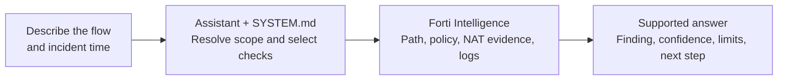

# Forti Intelligence MCP server

Understand why a connection fails, which firewall handles it, and what evidence supports the answer. Forti Intelligence connects an MCP-compatible assistant to your FortiManager and FortiAnalyzer so you can investigate Fortinet networks in plain language.

The server brings inventory, routing, policies, inspection profiles, current firewall state, and logs into one investigation. It helps the assistant follow traffic across managed firewalls, compare configuration with observed events, and explain the next useful check with the device and policy identifiers an administrator needs.

Forti Intelligence is open source, self-hosted, and read-only at the tool boundary. It supports multiple named appliance connections, scoped ADOM access, and local stdio or Streamable HTTP clients. You build and run it against your own appliances; credentials and the MCP endpoint belong to your deployment.

## One MCP endpoint for multiple FortiGates

The MCP host connects to FortiManager and, optionally, FortiAnalyzer over their JSON-RPC APIs. FortiManager supplies the managed-device inventory and stored configuration; FortiAnalyzer supplies recorded traffic and security events. The assistant can investigate multiple FortiGates, VDOMs, ADOMs, and manager profiles through one Forti Intelligence endpoint, without configuring a separate MCP connection or credentials for each FortiGate.

**No direct FortiGate access is required from the MCP host, including for URL rating.** Current policy lookups, sessions, operational monitors, and FortiGuard rating are requested through FortiManager's device proxy. Fresh proxy calls require FortiManager to reach the selected FortiGate; rating also requires that FortiGate to obtain a FortiGuard answer. Stored configuration and already collected analyzer logs remain useful when live device access is unavailable. See [connectivity and evidence sources](docs/configuration.md#connectivity-and-evidence-sources) for the exact dependencies.

## How this differs from FortiOS 8.0 MCP support

Fortinet's [FortiOS 8.0 agentic AI protocol documentation](https://docs.fortinet.com/document/fortigate/8.0.0/new-features/845410/agentic-ai-protocol-support-in-fortios) describes detection of MCP and A2A traffic using application control, with results in logs and FortiView. That documented feature inspects AI-related network activity; it does not describe a public FortiGate-hosted MCP troubleshooting server.

| Aspect | FortiOS 8.0 MCP traffic inspection | Forti Intelligence MCP server |
| --- | --- | --- |
| Purpose | Detect and monitor agentic AI protocols in network traffic. | Let an assistant investigate Fortinet traffic paths, policies, inspection, operational state, and incidents. |
| Role of FortiGate | Inspects traffic at the firewall and records protocol activity. | Supplies stored configuration through FortiManager and current state through its device proxy. |
| Scope | MCP/A2A activity visible at the inspecting firewall. | Multiple managed FortiGates, VDOMs, ADOMs, and manager profiles, with separate analyzer log scope. |
| Evidence | Application-control signatures, AI-specific log fields, and FortiView. | Inventory, configured routes/policies, proxied live reads, and FortiAnalyzer traffic/security logs. |

Forti Intelligence uses supported FortiManager and FortiAnalyzer JSON-RPC APIs. It does not rely on FortiOS 8.0 MCP inspection or a native appliance MCP endpoint. This provides a central investigation interface for the managed environment; version and permission requirements still apply to each underlying read.

## What it helps you do

| Your question | What the assistant can establish |
| --- | --- |
| “Why can this client not reach that server?” | An ordered configured path, policy decisions at each supported hop, and matching incident logs when available. |
| “Which firewall or network contains this IP?” | Scoped interface and zone candidates, package assignments, overlaps, and inventory freshness. |
| “Why is this website blocked?” | Its FortiGuard category, URL-specific overrides, carrying policies, web-filter decisions, and SSL/SSH inspection settings. |
| “Why does live behavior differ from FortiManager?” | Current lookup evidence, stored package installation state, available revision details, dynamic-routing neighbors, and SD-WAN health. |
| “Was this flow translated, and who holds this address?” | Candidate NAT objects, current sessions, and DHCP, ARP, FSSO, or firewall-user records. Actual translation needs session or log evidence. |
| “Are VPN, HA, or logging issues involved?” | Tunnel and login state, HA peer/checksum evidence, log-receipt information, and scoped appliance diagnostics. |
| “Where is this policy object used?” | References in supported policy tables, live policy hits, and any gaps that prevent a complete usage conclusion. |

You can begin with a symptom. Source and destination, protocol and ports, site or device, and incident time with timezone make the investigation more precise. The assistant can discover scope through the tools and ask for facts the available evidence cannot establish.

## From a question to a supported answer

Use the example [SYSTEM.md instructions](SYSTEM.md) in your assistant's system-instruction field. They guide scope resolution, per-hop checks, NAT handling, incident correlation, and reporting. The server also supplies built-in investigation guidance to MCP clients; `SYSTEM.md` adds a fuller process. Client support for custom instructions varies.

For example:

> Investigate why client `10.1.0.10` cannot reach server `10.30.0.20` over TCP/443 at `2026-10-02 10:05 UTC`. Show each firewall, policy and translation, the evidence for any block, and what remains unverified.

These values are fictional. This flow shows how the assistant combines the MCP capabilities with `SYSTEM.md`:



The [visual investigation guide](docs/use-cases.md) walks through this two-firewall incident and a website block. It includes tool-call examples, translation handling, decision branches, and a fictional final report.

## What to expect from an answer

Expect a conclusion and confidence level first, followed by the flow and firewalls in order. For each hop, the assistant should identify scope, ingress and egress, route, policy/action, relevant inspection, and verified translation. Evidence should name its source and time: inventory, configuration, current lookup, or observed logs.

The answer should state the first unsupported link, any conflicting or partial reads, return-path coverage, and the smallest useful next check. A confirmed block on one firewall does not confirm the whole topology. A configured allow does not prove application delivery; empty logs do not prove traffic never occurred. Dynamic routing, NAT, installed-package state, endpoint health, or systems outside the inventory can leave gaps.

The MCP does not install policies, edit configuration, execute scripts, or commit workspaces. It supports diagnosis and recommendations for human review. Log searches create read-oriented analyzer search tasks, and URL rating can use a narrowly permitted rating POST; these can require additional API permissions. See the [log-search](docs/tools/search_fortianalyzer_logs.md#behavior-and-limits) and [URL-rating](docs/tools/rate_url.md#behavior-and-limits) documentation.

## Get started

You need Go 1.25 or newer or Docker, an MCP client, network access to your appliances, and least-privilege API accounts. Core FortiManager reads target 7.4.x or newer; FortiAnalyzer 7.x or newer is optional for log workflows. Release-specific proxy resources and permissions still need verification on your appliances.

Copy [config.example.yaml](config.example.yaml) to a private local configuration. Set the appliance URLs and allowed ADOMs, then supply its credential variables through your shell, MCP client, or deployment secret store. A `.env` file is not loaded automatically. If using FortiAnalyzer, set its profile `timezone`; remove that profile for FortiManager-only use.

```sh
git clone https://github.com/synit-io/forti-intelligence.git
cd forti-intelligence
cp config.example.yaml ./forti-intelligence.yaml
chmod 600 ./forti-intelligence.yaml
export FMG_USERNAME=api-readonly
export FMG_PASSWORD='replace-with-your-FortiManager-password'
# Only if you retain the FortiAnalyzer profile:
export FAZ_USERNAME=api-readonly
export FAZ_PASSWORD='replace-with-your-FortiAnalyzer-password'
go build -trimpath -o ./bin/forti-intelligence ./cmd/forti-intelligence
```

Edit the copied YAML and replace placeholder credentials before starting. Point your MCP client's stdio configuration at the built binary:

```json
{
  "mcpServers": {
    "forti-intelligence": {
      "command": "/absolute/path/forti-intelligence/bin/forti-intelligence",
      "args": [
        "--config",
        "/absolute/path/forti-intelligence.yaml",
        "--transport",
        "stdio"
      ]
    }
  }
}
```

If the client starts with a clean environment, add the credential variables to its `env` configuration. Inventory loads in the background; early queries can report that it is still loading.

For multiple appliance profiles, permissions, private CAs, Streamable HTTP, bearer authentication, and Docker, follow the [configuration and deployment guide](docs/configuration.md). For freshness, caching, partial reads, or slow requests, see [operations and diagnostics](docs/operations.md). Restrict MCP access to intended users and review your client's model-provider data-sharing settings before sending sensitive inventory, identities, or logs.

Release containers publish to [`synitio/forti-intelligence` on Docker Hub](https://hub.docker.com/r/synitio/forti-intelligence) for AMD64 and ARM64 after CI passes. See [Docker publishing](docs/configuration.md#publish-to-docker-hub) for release tags, manual runs, and required repository secrets.

## Documentation

- [Visual investigation guide](docs/use-cases.md): traffic and website examples using `SYSTEM.md`.
- [Tool reference](docs/tools/README.md): all 29 tools, each with a dedicated page for inputs, examples, behavior, freshness, and limits.
- [Configuration and deployment](docs/configuration.md): appliance requirements, permissions, profiles, and client connections.
- [Operations and diagnostics](docs/operations.md): inventory, caching, error handling, and request timing.
- [SYSTEM.md](SYSTEM.md): example assistant investigation and reporting instructions.
- [CONTEXT.md](CONTEXT.md): scope and ownership terms used in reports.

## Contributing

Issues and pull requests are welcome through [synit-io/forti-intelligence](https://github.com/synit-io/forti-intelligence). Describe the use case, affected versions, expected behavior, and a minimal reproduction. Update affected tool documentation when behavior changes. Use synthetic fixtures and anonymized examples; keep credentials, customer identifiers, appliance captures, and sensitive topology out of commits and issues. Name ADOM fixtures `test-adom-*`, and use synthetic device names consistently in requests, mocked responses, and assertions.

Run the project checks before submitting code changes:

```sh
go test -race ./...
go vet ./...
go build -trimpath -o bin/forti-intelligence ./cmd/forti-intelligence
docker build -t forti-intelligence:local .
```

## License

Forti Intelligence's original code and documentation are licensed under the [Apache License, Version 2.0](LICENSE). Dependency licenses and attribution notices are preserved in [THIRD_PARTY_NOTICES.md](THIRD_PARTY_NOTICES.md). Include both files with redistributed binaries and container images.
