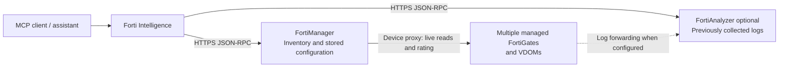

# Configuration and deployment

Build and connect a self-hosted server to your own Fortinet appliances. For capabilities and expected answers, start with the [project overview](../README.md).

## Requirements

- Go 1.25 or newer to build locally (latest stable recommended), or Docker to build and run the container
- An MCP client supporting stdio or Streamable HTTP
- FortiManager 7.4.x or newer with JSON API access enabled for inventory and FortiGate investigations
- FortiAnalyzer 7.x or newer with JSON API access enabled for analyzer status and log workflows (optional for FortiManager-only use)
- A least-privilege JSON API administrator per appliance/profile
- HTTPS access from the MCP host to the configured FortiManager and optional FortiAnalyzer profiles, and DNS access for hostname lookups

The official MCP Go SDK is pinned to v1.8.0, which supports MCP protocol `2026-07-28` and older negotiated versions.

Dependency maintenance is configured in [`.github/dependabot.yml`](../.github/dependabot.yml). Dependabot checks daily for Go module updates (including indirect dependencies), Docker image updates, and GitHub Actions updates, including major releases. Keep dependency pins on stable releases: Dependabot excludes prereleases when the current version is stable. Review update pull requests and their CI results before merging.

CI selects Go's `stable` alias, so tests and vet always run on the latest stable release. The Docker builder uses an explicit stable Go version maintained by Dependabot. The runtime image is pinned by digest so Dependabot can propose updates even when its `nonroot` tag stays unchanged. The `go` directive in `go.mod` remains the minimum supported Go version; it does not select the CI or Docker compiler.

FortiManager 7.4.x and newer are supported for the core ADOM, device, policy-package, object, interface, and policy-read routes. IPv6 policies are read from `firewall/policy`, which holds IPv4 and IPv6 policies since FortiOS 6.4 (separate `srcaddr6`/`dstaddr6` columns), plus the legacy `policy6` table of older ADOMs, whose absence is cached; `policy64` holds NAT64 policies and is not read as IPv6 policies. Live policy lookup is proxied to the managed FortiGate, so its availability also depends on the target FortiOS release and API permissions, not only on the FortiManager version.

## Connectivity and evidence sources

Forti Intelligence opens appliance connections only to the configured FortiManager and FortiAnalyzer HTTPS endpoints. It uses their JSON-RPC APIs, not a native FortiGate MCP endpoint. Neither the assistant nor the MCP host needs direct FortiGate API reachability or separate FortiGate API credentials. This also applies to URL rating: any dedicated rating account authenticates to FortiManager.



| Evidence or operation | MCP host connects to | Additional dependency |
| --- | --- | --- |
| Inventory, interfaces/zones, configured routes, policies/objects, package state, and web-filter configuration | FortiManager | Readable manager database and permitted ADOM scope. These reads do not contact the FortiGate directly. |
| Historical traffic/security logs and log receipt | FortiAnalyzer | Logs must already have been forwarded and retained in the selected analyzer scope. Searching existing records does not require a live FortiGate connection. |
| Current policy lookup, sessions, identities, VPN/HA state, and operational routing monitors | FortiManager | The manager must reach the managed FortiGate and permit the requested `/sys/proxy/json` read. |
| FortiGuard URL rating and device category lists | FortiManager | The manager must reach the selected rating FortiGate; rating requires a FortiGuard answer and the documented proxy permissions. |

Uncached current device reads and URL rating therefore still depend on a reachable FortiGate, through FortiManager. URL rating is not the only operation with that dependency. An offline device can still contribute manager-stored configuration and previously collected analyzer logs; label their timestamps and visibility limits rather than treating them as live state.

The host also uses DNS for destination hostnames. Model-provider connectivity and data handling belong to your MCP client, outside the appliance connections described here. See the tool pages for cache freshness, supported resources, and partial-read behavior.

## Configure

Clone the repository and copy [config.example.yaml](../config.example.yaml) to a private local configuration. Edit its appliance URLs, profile names, permitted ADOMs, and FortiAnalyzer timezone. Remove the FortiAnalyzer profile if you only use FortiManager. The loader expands `${ENV_VAR}` references in YAML, so credentials do not need to be written to the file:

```sh
git clone https://github.com/synit-io/forti-intelligence.git
cd forti-intelligence
cp config.example.yaml ./forti-intelligence.yaml
chmod 600 ./forti-intelligence.yaml
export FMG_USERNAME=api-readonly
export FMG_PASSWORD='replace-with-your-FortiManager-password'
# Only if you retain the FortiAnalyzer profile:
export FAZ_USERNAME=api-readonly
export FAZ_PASSWORD='replace-with-your-FortiAnalyzer-password'
```

The variable names above match `config.example.yaml`. Set them through your shell, MCP client, or deployment secret store; a `.env` file is not loaded automatically. The copied configuration is ignored by Git. Replace the placeholder passwords before starting and keep real credentials out of commits and shared examples.

### FortiManager and FortiAnalyzer profiles

Every `profiles` entry is an independent named connection. Add as many FortiManager (`product: fortimanager`) and FortiAnalyzer (`product: fortianalyzer`) profiles as needed. Profile names must be unique. For profile-specific tools, `default: true` is selected separately per product when a tool call does not specify `profile`; mark at most one profile of each product as the default. `lookup_firewall_policy` is intentionally cross-profile when `profile` is omitted and searches all inventoried FortiManager profiles.

FortiManager profiles may set `adoms` to an array of permitted ADOM names. The allowlist applies to ADOM discovery, managed-device/interface/package/object/policy reads, proxy reads, and policy lookup. When it is set, the configured names are used directly and the server does not call `/dvmdb/adom` to discover unrelated ADOMs. Omit it to preserve unrestricted ADOM discovery. This is useful when FMG exposes product/default ADOMs that are not readable or do not contain FortiGates; those ADOMs are never sent to later inventory stages.

This is a complete 1..N layout pattern:

```yaml
profiles:
  - name: fmg-prod
    product: fortimanager
    url: "https://fmg-prod.example.com"
    username: "${FMG_PROD_USERNAME}"
    password: "${FMG_PROD_PASSWORD}"
    ca_file: "/etc/forti-intelligence/fmg-prod-ca.pem" # optional
    default: true

  - name: fmg-dr
    product: fortimanager
    url: "https://fmg-dr.example.com"
    api_key: "${FMG_DR_API_KEY}"
    default: false

  - name: faz-prod
    product: fortianalyzer
    url: "https://faz-prod.example.com"
    username: "${FAZ_PROD_USERNAME}"
    password: "${FAZ_PROD_PASSWORD}"
    default: true

  - name: faz-archive
    product: fortianalyzer
    url: "https://faz-archive.example.com"
    api_key: "${FAZ_ARCHIVE_API_KEY}"
    default: false
```

Set `timezone` (IANA name such as `Europe/Berlin`) on FortiAnalyzer profiles. FortiAnalyzer interprets Log View time ranges as wall-clock values in its own or the ADOM time zone; with `timezone` set, RFC3339 inputs with any offset are converted before they are sent. Without it the caller's wall clock is sent unchanged and every search result carries a warning.

Use either `username` + `password` or `api_key` for each profile. An API key is sufficient by itself; do not add a username or password unless you intentionally want session-based authentication. Username/password uses JSON-RPC session login/logout. API-key profiles send `Authorization: Bearer` and never put the key in the request URL. Profile URLs must use HTTPS; `allow_insecure_http: true` is available only for controlled HTTP test/lab endpoints. `insecure_skip_verify` is available for lab certificates; use `ca_file` for a trusted private CA in production. Optional static headers can be supplied with `headers:`.

For unrestricted FortiManager inventory, the REST API administrator's assigned profile must be allowed to read the inventory resource `/dvmdb/adom`, not only policy objects inside individual ADOMs. With an explicit `adoms` allowlist, `/dvmdb/adom` discovery is skipped, but the administrator still needs read permission for the configured ADOM device/package/interface resources. At minimum, verify JSON API Access is `Read`, the profile has `System Settings` (`system-setting`) and `Administrative Domain` (`adom-switch`) set to `Read`, and the administrator is assigned to every intended ADOM. For the later device/package stages, also grant the corresponding read-only Device Manager and Policy Packages & Objects permissions. A `code -11: No permission for the resource` response means the appliance rejected that effective permission scope; the server records the appliance code/message and the profile/stage in its error log.

Inventory starts in the background. See [inventory freshness and diagnostics](operations.md#inventory-freshness-and-scope) before interpreting an incomplete first snapshot.

### Start the MCP server

For a local MCP client, stdio is usually the simplest transport. Build a binary or run from the repository:

```sh
go build -trimpath -o ./bin/forti-intelligence ./cmd/forti-intelligence
./bin/forti-intelligence --config "$PWD/forti-intelligence.yaml" --transport stdio
```

The process uses stdout for MCP traffic and stderr for logs. A typical client-side `mcpServers` entry is:

```json
{
  "mcpServers": {
    "forti-intelligence": {
      "command": "/absolute/path/forti-intelligence/bin/forti-intelligence",
      "args": [
        "--config",
        "/absolute/path/forti-intelligence.yaml",
        "--transport",
        "stdio"
      ]
    }
  }
}
```

The Streamable HTTP endpoint is configured in stateless mode for MCP protocol `2026-07-28`. Therefore the SDK intentionally does not send or retain an `Mcp-Session-Id`; lifecycle log lines with `session_id=""` are normal, not a Fortinet authentication failure. Fortinet appliance sessions/API keys and the inventory cache are independent of the MCP transport session.

If the MCP client starts the process with a clean environment, add the variables referenced by the YAML to that client's `env` section. The exact configuration filename and remote-server syntax differ between MCP clients; keep the command, arguments, and absolute paths from the example.

For Streamable HTTP, set the bearer token before starting the server:

```sh
export FORTI_MCP_HTTP_TOKEN="$(openssl rand -hex 32)"
./bin/forti-intelligence --config "$PWD/forti-intelligence.yaml" --transport http
```

The default endpoint is `http://127.0.0.1:8080/mcp`; health is available at `/healthz` and reports inventory readiness, whether a refresh is running, age, device count, offline device count, refresh error count and stale profiles. HTTP startup fails immediately if the address cannot be bound and logs the actual bound address. Shutdown drains active requests for up to 30 seconds, then closes remaining connections. The HTTP write timeout follows `server.refresh_timeout` so long lookups are not cut off. A panic inside a tool is logged with its stack and returned as a tool error; the server keeps serving. The container image starts the HTTP transport on `0.0.0.0:8080` and reads `/etc/forti-intelligence/config.yaml` (override with `FORTI_INTELLIGENCE_CONFIG`); mount the configuration and set `FORTI_MCP_HTTP_TOKEN`. A client configured for remote MCP can use the MCP URL and send `Authorization: Bearer <FORTI_MCP_HTTP_TOKEN>` on requests. The illustrative connection settings are:

```json
{
  "url": "http://127.0.0.1:8080/mcp",
  "headers": {
    "Authorization": "Bearer <FORTI_MCP_HTTP_TOKEN>"
  }
}
```

Keep the listener on localhost unless an authenticated reverse proxy and an explicit network policy protect it. Non-loopback HTTP requires `http_bearer_token` or the explicit `http_trusted_proxy: true` setting. Override the bind address with `--listen` or `server.listen_address`.

### Run with Docker

After configuring the YAML and exporting its credential variables, build the image locally and bind its HTTP endpoint to localhost:

```sh
docker build -t forti-intelligence:local .
docker run --rm \
  --user "$(id -u):$(id -g)" \
  --publish 127.0.0.1:8080:8080 \
  --mount "type=bind,src=$PWD/forti-intelligence.yaml,dst=/etc/forti-intelligence/config.yaml,readonly" \
  --env FMG_USERNAME --env FMG_PASSWORD \
  --env FAZ_USERNAME --env FAZ_PASSWORD \
  --env FORTI_MCP_HTTP_TOKEN \
  forti-intelligence:local
```

The image runs as UID 65532 by default. This example uses your host UID/GID so it can read the owner-only configuration created above. Set `FORTI_MCP_HTTP_TOKEN` as in the HTTP example. Mount any configured private CA files at their YAML paths, ensure they are readable by the container user, and pass additional environment variables if you add profiles. `/ready` reports whether the first inventory snapshot exists; `/metrics` exposes Prometheus metrics. With bearer authentication configured, include the token on HTTP requests to these endpoints and `/healthz`.

The build context excludes local configurations, environment files, private keys/certificates, logs, and the ignored local `testdata/` capture directory. The image includes the project license and dependency notices at `/usr/share/doc/forti-intelligence/`.

### Publish to Docker Hub

The [Publish container workflow](../.github/workflows/publish.yml) publishes `synitio/forti-intelligence` for `linux/amd64` and `linux/arm64`. It runs on version-tag pushes matching `v*.*.*` and manual runs. The selected tag must exist and be a semantic version such as `v0.1.0` or `v0.2.0-rc.1`. Both paths run the existing Go race tests, `go vet`, and Docker build against that same tag before logging in and publishing.

Configure these GitHub Actions repository secrets before the first run:

| Secret | Value |
| --- | --- |
| `DOCKERHUB_USERNAME` | Docker Hub account with permission to push to `synitio/forti-intelligence`. |
| `DOCKERHUB_TOKEN` | Docker Hub access token for that account with write permission to the repository. |

Once the workflow changes are on the default branch, publish a release by pushing a version tag on a commit containing them:

```sh
git tag v0.1.0
git push origin v0.1.0
```

To publish an existing tag again, open **Actions → Publish container → Run workflow** on the default branch and supply that tag in the `tag` input. The tagged Dockerfile must support the `VERSION` build argument to embed the release version in both the CLI and MCP server metadata.

A stable tag such as `v0.1.0` publishes `0.1.0`, `0.1`, and `latest`. A prerelease such as `v0.2.0-rc.1` publishes only `0.2.0-rc.1`. Manual runs update the same tags, so republishing an older stable release also moves `latest` and its minor alias to that release. Version tags and OCI labels identify the image; `--version` reports its embedded version.

After a successful publish, pull a specific version and use it in place of `forti-intelligence:local` in the Docker run example:

```sh
docker pull synitio/forti-intelligence:0.1.0
docker run --rm synitio/forti-intelligence:0.1.0 --version
```

## Deployment security

Give each deployment its own least-privilege appliance accounts and restrict its ADOM scope. FortiAnalyzer Log View task creation and FortiGuard rating can require additional JSON API permission; see the [log-search permissions](tools/search_fortianalyzer_logs.md#behavior-and-limits) and [URL-rating permissions](tools/rate_url.md#behavior-and-limits) before widening access. Use trusted TLS certificates or configured private CAs. HTTP shared across hosts needs authenticated access and HTTPS at the reverse proxy.

Tool results can contain network inventory, user identities, and traffic logs. Grant MCP access only to intended users and assistants, and review the data-sharing settings of the MCP client and any connected model provider before sending sensitive results. Source-code availability does not make your deployed MCP endpoint public.

[Tool reference](tools/README.md) · [Operations](operations.md) · [Investigation flow guide](use-cases.md)
