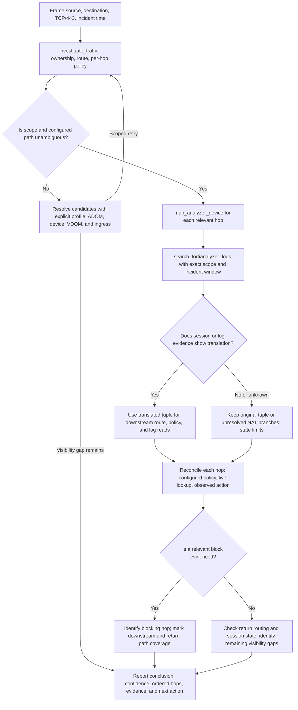
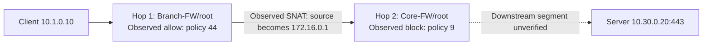
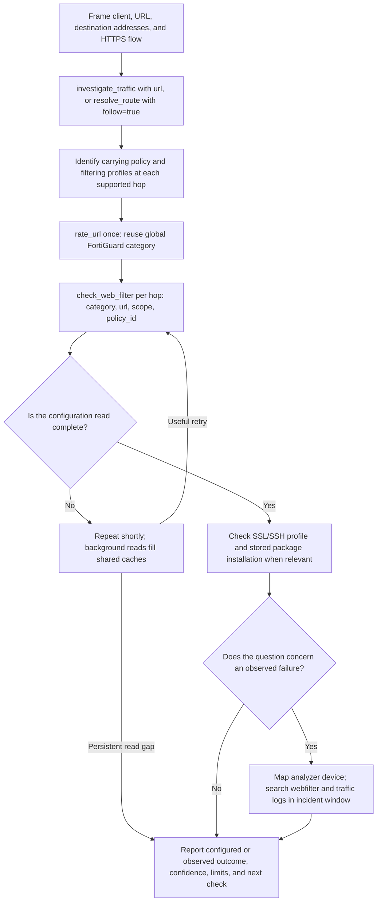

# Visual investigation guide

These examples show how an assistant combines Forti Intelligence tools with the investigation process in [SYSTEM.md](../SYSTEM.md). All addresses, profiles, devices, timestamps, policy IDs, log names, and outcomes below are fictional. Replace them with verified results; do not treat the example verdicts as real appliance evidence.

The server supplies evidence. The assistant resolves scope, selects follow-up reads, reconciles results, and writes the answer. `SYSTEM.md` guides that work; it does not add tools or grant configuration-changing capabilities. The live MCP descriptions and schemas define the available inputs and limits.

## Example 1: Find a block across two firewalls

> Client `10.1.0.10` cannot reach server `10.30.0.20` over TCP/443. The failure occurred at `2026-10-02 10:05 UTC`. Find the blocking firewall and policy, show any address translation, and state what remains unverified.

This example expands the [multi-hop report in SYSTEM.md](../SYSTEM.md#example-multi-hop-report). The client is behind `Branch-FW/root`; `Core-FW/root` is the next managed boundary. In the fictional evidence, the branch translates the source to `172.16.0.1`, and the core denies it with policy 9.

### Investigation flow



An ambiguous scope must remain separate candidate branches until evidence resolves it. An unfinished or denied read is a limitation, not a verdict. A configured path can continue beyond a block; label independently known downstream configuration separately from evidence that this attempt reached it.

### 1. Establish the configured path and policy candidates

Start with [`investigate_traffic`](tools/investigate_traffic.md). Scope is optional when unknown; add verified selectors once discovered.

```json
{
  "source_ip": "10.1.0.10",
  "destination_ip": "10.30.0.20",
  "destination_port": 443,
  "protocol": "tcp"
}
```

Read ownership candidates, inventory freshness, `route.path.end`, and every entry in `hops`. Top-level `policy` and `web_filter` cover only the first hop. The configured route does not prove forwarding, actual NAT, or the return path.

For a focused follow-up, use [`resolve_route`](tools/resolve_route.md) with `follow: true` and the source-side scope. Use [`get_routing_neighbors`](tools/get_routing_neighbors.md) and a live [`get_fortigate_settings`](tools/get_fortigate_settings.md) routing read when dynamic routing or SD-WAN can change the configured answer.

### 2. Map analyzer identity and retrieve incident evidence

Resolve the logged device identity for each relevant firewall. FortiAnalyzer ADOMs and device names can differ from FortiManager names. For the branch:

```json
{
  "profile": "example-fmg",
  "adom": "example-network",
  "device": "Branch-FW",
  "analyzer_profile": "example-faz",
  "analyzer_adom": "example-adom"
}
```

Pass this input to [`map_analyzer_device`](tools/map_analyzer_device.md). In this example, the verified logged name is `Branch-FW-logged`. Search with [`search_fortianalyzer_logs`](tools/search_fortianalyzer_logs.md):

```json
{
  "profile": "example-faz",
  "adom": "example-adom",
  "device": "Branch-FW-logged",
  "log_type": "traffic",
  "filter": "srcip=10.1.0.10 and dstip=10.30.0.20 and dstport=443 and proto=6",
  "start": "2026-10-02T10:00:00Z",
  "end": "2026-10-02T10:10:00Z",
  "limit": 25
}
```

Filter fields must be supported by the analyzer release; discover them with [`get_fortianalyzer_data`](tools/get_fortianalyzer_data.md) if needed. Keep logged VDOM, time, interfaces, policy ID, and tuple in the evidence record. `complete` means task completion only at 100%; a full page can require another search or page. Resume unfinished searches with `task_id` and the same analyzer profile/ADOM. Check [`get_log_receipt`](tools/get_log_receipt.md) and search coverage before interpreting zero rows.

### 3. Verify translation before downstream checks

Suppose the branch accept log records policy 44 and source translation from `10.1.0.10` to `172.16.0.1`. That is observed translation for this incident. [`get_firewall_sessions`](tools/get_firewall_sessions.md) can supply current session evidence; [`get_nat_for_flow`](tools/get_nat_for_flow.md) supplies candidate configuration only.

The investigation wrapper uses the original tuple downstream. Repeat the core route and policy checks with the observed translated source. For [`lookup_firewall_policy`](tools/lookup_firewall_policy.md):

```json
{
  "profile": "example-fmg",
  "adom": "example-network",
  "device": "Core-FW",
  "vdom": "root",
  "source_interface": "transit",
  "source_ip": "172.16.0.1",
  "destination_ip": "10.30.0.20",
  "destination_port": 443,
  "protocol": "tcp"
}
```

Here `transit` is a proven ingress interface, not a name chosen from a similar zone. Repeat routing with [`resolve_route`](tools/resolve_route.md), using `ip` for the destination and the translated flow inputs. Preserve unknown source ports; constrained matches remain tentative.

Map `Core-FW` separately, then search its verified analyzer identity with `srcip=172.16.0.1`, the same destination/protocol/port, and the incident window. If the core log confirms policy 9 denied that tuple, the block is observed. If live lookup and FortiManager disagree, inspect [`get_package_install_status`](tools/get_package_install_status.md) and retain both results.

### Example path and answer

This diagram represents only the fictional correlated evidence described above. The path after the block is unverified.



**Conclusion:** The attempt is blocked at hop 2 by policy 9 on `Core-FW/root`, confirmed by a correlated deny log. Application delivery and the return path are unverified.

**Flow:** IPv4 TCP/443 from `10.1.0.10` to `10.30.0.20`, at `2026-10-02 10:05 UTC`.

| Hop | Ingress / egress | Finding | Translation and evidence |
| --- | --- | --- | --- |
| 1. `Branch-FW/root` | `lan` / `transit` | Observed allow, policy 44 | Accept log records source changing to `172.16.0.1`; configured route identifies the core gateway at `172.16.0.2`. |
| 2. `Core-FW/root` | `transit` / not forwarded | Observed block, policy 9 | Correlated deny log sees source `172.16.0.1`; segment toward the server remains unverified. |

**Evidence:** Branch and core `search_fortianalyzer_logs` records use analyzer profile `example-faz`, ADOM `example-adom`, their separately mapped logged identities/VDOMs, and the stated incident window. `resolve_route` supplies configuration evidence from profile `example-fmg`, ADOM `example-network`, at the recorded inventory snapshot time. An actual answer must cite the returned timestamps and identifiers.

**Return path:** Not checked after the forward block. **Next action:** Ask the owner of `Core-FW/root` to review policy 9 for this tuple; any configuration change requires human review.

## Example 2: Explain a website block

> Client `10.1.0.10` cannot open `https://www.example.com/path` over HTTPS. Which hop filters it, and is the reason a URL rule, category, or inspection setting?

Use the client's actual destination address when available. MCP-host DNS may differ; keep alternative addresses and IP families separate. This is initially a configuration question. Add the incident time/timezone and analyzer evidence before claiming an observed block.



[`investigate_traffic`](tools/investigate_traffic.md) with `url` rates once and checks each traced hop. For separate reads, first trace the path; then call [`rate_url`](tools/rate_url.md) with a verified device. If the server advertises a configured rating FortiGate, rating can run while the path is being resolved.

Suppose the rating returns category `52`, and hop 1's carrying policy is `44`. Call [`check_web_filter`](tools/check_web_filter.md):

```json
{
  "profile": "example-fmg",
  "adom": "example-network",
  "device": "Branch-FW",
  "vdom": "root",
  "policy_id": 44,
  "category": "52",
  "url": "https://www.example.com/path"
}
```

Use the actual returned category and each hop's own carrying policy. Always include the concrete URL: static URL filters and local rating overrides can change the result. When rating fails, inspect `rating.error` and `rating.attempt_errors`; a URL-only check still evaluates URL rules but leaves category actions unknown. Repeat `complete: false` checks after a short pause rather than treating incomplete profile or policy coverage as permission.

Read [`get_ssl_ssh_profile`](tools/get_ssl_ssh_profile.md) for the carrying policy's inspection profile when HTTPS path visibility or certificate handling matters. Check [`get_package_install_status`](tools/get_package_install_status.md) when the package is modified or differs from current lookup. Stored filtering is configuration evidence, not proof of live enforcement.

For an observed failure, map each relevant device and search `log_type: webfilter` in its analyzer scope and incident window. Correlate the tuple as seen at that hop, policy, VDOM, and time; traffic admission can succeed before inspection blocks. Keep partial searches and logging gaps explicit.

An expected answer identifies which hop and profile has a configured or observed block, distinguishes URL/category decisions from firewall admission and inspection conditions, states confidence, and gives one concrete next check. Do not claim that category rating proves the site is reachable or that a missing block log proves it was allowed.

## How the guide relates to SYSTEM.md

| SYSTEM.md instruction | What these examples demonstrate |
| --- | --- |
| [1. Frame the question](../SYSTEM.md#1-frame-the-question) | Separate configuration questions from incidents; collect the flow, time, and DNS context. |
| [2. Resolve scope](../SYSTEM.md#2-resolve-scope-and-maintain-an-evidence-record) | Keep overlapping ownership candidates separate and map analyzer identity independently. |
| [3. Select reads](../SYSTEM.md#3-select-reads-that-resolve-uncertainty) | Choose focused tools for the specific routing, translation, policy, or logging gap. |
| [4. Trace boundaries](../SYSTEM.md#4-trace-traffic-across-every-relevant-boundary) | Inspect every relevant device/VDOM, carry verified translations downstream, and check return-path coverage. |
| [5. Correlate incidents](../SYSTEM.md#5-correlate-observed-incidents) | Search the correct per-hop tuple and time window; preserve completion, pagination, and ingestion limits. |
| [6. Reconcile and answer](../SYSTEM.md#6-reconcile-and-answer) | State conclusion/confidence first, then ordered hop findings, evidence, return-path limits, and next action. |

Stop when the question has sufficient evidence or supported reads are exhausted. A visibility gap should lead to a scoped next check or administrator escalation, not an unrelated audit.

[Project overview](../README.md) · [Tool reference](tools/README.md) · [Configuration](configuration.md) · [Operations](operations.md)
