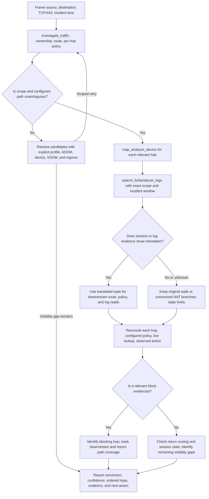
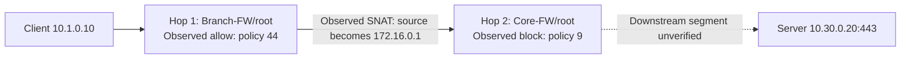
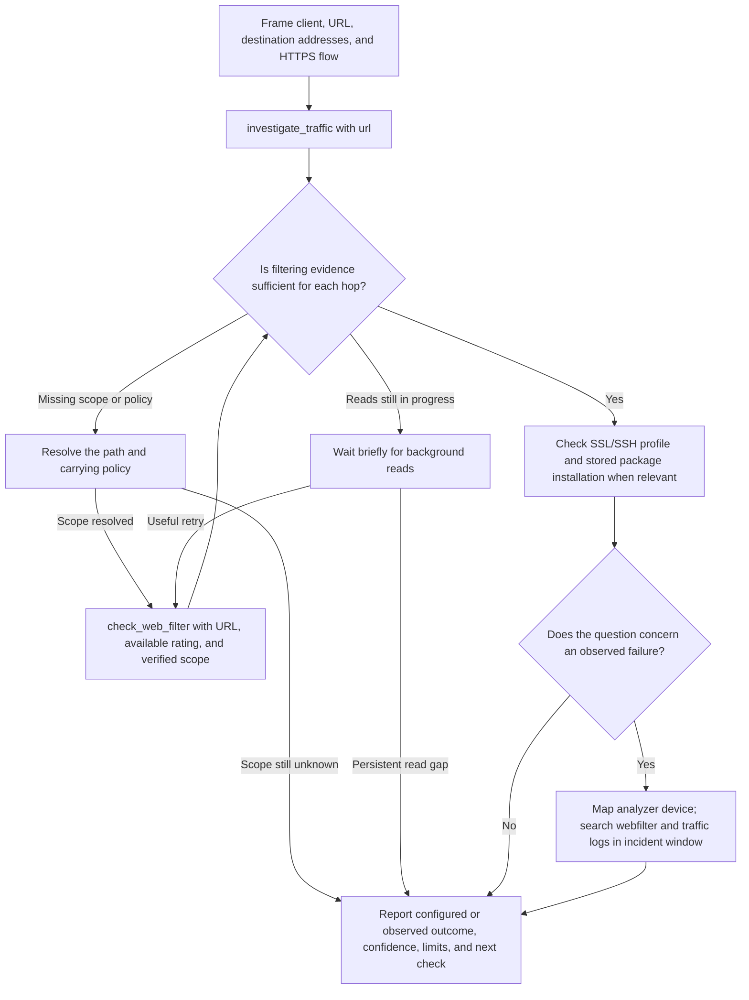

# Visual investigation guide

These Forti Intelligence v2.3.1 examples cover a blocked connection, a blocked website, and a failed MCP call. All names, addresses, identifiers, times, and outcomes are fictional.

For network incidents, the assistant follows the investigation process in [SYSTEM.md](../SYSTEM.md). Check the tools advertised by the running server before each workflow or follow-up. An administrator can disable individual tools. If a needed read is unavailable, identify the evidence gap. The audit example is for an operator with access to the server logs.

## Example 1: Find a block across two firewalls

> Client `10.1.0.10` cannot reach server `10.30.0.20` over TCP/443. The failure occurred at `2026-10-02 10:05 UTC`. Find the blocking firewall and policy, show any address translation, and state what remains unverified.

This example follows the [traffic investigation instructions in SYSTEM.md](../SYSTEM.md#3-traffic-investigation). The client is behind `Branch-FW/root`; `Core-FW/root` is the next managed boundary. In the fictional evidence, the branch translates the source to `172.16.0.1`, and the core denies it with policy 9.

### Investigation flow



An ambiguous scope must remain separate candidate branches until evidence resolves it. An unfinished or denied read is a limitation, not a verdict. A configured path can continue beyond a block; label independently known downstream configuration separately from evidence that this attempt reached it.

### 1. Establish the configured path and policy candidates

Start with [`investigate_traffic`](tools/investigate_traffic.md). Scope is optional when unknown; add verified selectors once discovered.

```json
{
  "source_ip": "10.1.0.10",
  "destination_ip": "10.30.0.20",
  "destination_port": 443,
  "protocol": "tcp"
}
```

For an IPv4 ping, use `"protocol": "icmp"`, `"icmp_type": 8` and `"icmp_code": 0`, and omit both ports. For an IPv6 echo request, use `"protocol": "icmpv6"` and type `128` with code `0`.

Read ownership candidates, inventory freshness, `route.path.end`, and every entry in `hops`. Add `detail: "compact"` when duplicate/raw evidence is unnecessary: canonical hops remain in `hops`, while duplicate route-hop arrays are null. In the full view, top-level `policy` and `web_filter` duplicate the first hop when hops exist; with no traced hop, inspect any fallback top-level policy. The configured route does not prove forwarding, actual NAT, or the return path.

For a focused follow-up, use [`resolve_route`](tools/resolve_route.md) with `follow: true` and the source-side scope. For the installed route, pass `live: true`, the device, its VDOM and the destination IP to the same tool. Use [`get_routing_neighbors`](tools/get_routing_neighbors.md) when dynamic routing or SD-WAN health may explain a difference.

### 2. Map analyzer identity and retrieve incident evidence

To include branch logs in the first call, set `include_logs: true`, `log_profile`, `log_adom`, `log_start`, and `log_end` for the incident. The tool searches the original flow once when it has a concrete destination. If it cannot verify the source device or VDOM, check those fields on each returned row. For a separate search, use the branch mapping below. For the core, use its own logged identity and the addresses it saw after translation.

FortiAnalyzer ADOMs and device names can differ from FortiManager names. To map the branch firewall, use this input.

```json
{
  "profile": "example-fmg",
  "adom": "example-network",
  "device": "Branch-FW",
  "analyzer_profile": "example-faz",
  "analyzer_adom": "example-adom"
}
```

Pass this input to [`map_analyzer_device`](tools/map_analyzer_device.md). In this example, the verified logged name is `Branch-FW-logged`. Search with [`search_fortianalyzer_logs`](tools/search_fortianalyzer_logs.md):

```json
{
  "profile": "example-faz",
  "adom": "example-adom",
  "device": "Branch-FW-logged",
  "log_type": "traffic",
  "filter": "srcip=10.1.0.10 and dstip=10.30.0.20 and dstport=443 and proto=6 and vd=\"root\"",
  "start": "2026-10-02T10:00:00Z",
  "end": "2026-10-02T10:10:00Z",
  "limit": 25
}
```

Filter fields must be supported by the analyzer release; discover them with [`get_fortianalyzer_data`](tools/get_fortianalyzer_data.md) if needed. Keep logged VDOM, time, interfaces, policy ID, and tuple in the evidence record. Use returned `complete` for execution status; synchronous responses can finish without progress. A full page can require another search or page. When `next_action` supplies a supported tool and arguments, validate scope and use those arguments to retain the original absolute window. Actions without callable arguments require scope/input recovery. On overflow, recover the same unseen offset rather than advancing past omitted records. Check [`get_log_receipt`](tools/get_log_receipt.md) and search coverage before interpreting zero rows.

### 3. Verify translation before downstream checks

Suppose the branch accept log records policy 44 and source translation from `10.1.0.10` to `172.16.0.1`. That is observed translation for this incident. [`get_firewall_sessions`](tools/get_firewall_sessions.md) can supply current session evidence; [`get_nat_for_flow`](tools/get_nat_for_flow.md) supplies candidate configuration only.

The investigation wrapper uses the original tuple downstream. Repeat the core route and policy checks with the observed translated source. For [`lookup_firewall_policy`](tools/lookup_firewall_policy.md):

```json
{
  "profile": "example-fmg",
  "adom": "example-network",
  "device": "Core-FW",
  "vdom": "root",
  "source_interface": "transit",
  "source_ip": "172.16.0.1",
  "destination_ip": "10.30.0.20",
  "destination_port": 443,
  "protocol": "tcp"
}
```

Here `transit` is a proven ingress interface, not a name chosen from a similar zone. Repeat routing with [`resolve_route`](tools/resolve_route.md), using `ip` for the destination and the translated flow inputs. Preserve unknown source ports; constrained matches remain tentative.

Map `Core-FW` separately, then search its verified analyzer identity with `srcip=172.16.0.1`, the same destination/protocol/port, and the incident window. If the core log confirms policy 9 denied that tuple, the block is observed. If live lookup and FortiManager disagree, inspect [`get_package_install_status`](tools/get_package_install_status.md) and retain both results.

### Example path and answer

This diagram represents only the fictional correlated evidence described above. The path after the block is unverified.



**Conclusion:** The attempt is blocked at hop 2 by policy 9 on `Core-FW/root`, confirmed by a correlated deny log. Application delivery and the return path are unverified.

**Flow:** IPv4 TCP/443 from `10.1.0.10` to `10.30.0.20`, at `2026-10-02 10:05 UTC`.

| Hop | Ingress / egress | Finding | Translation and evidence |
| --- | --- | --- | --- |
| 1. `Branch-FW/root` | `lan` / `transit` | Observed allow, policy 44 | Accept log records source changing to `172.16.0.1`; configured route identifies the core gateway at `172.16.0.2`. |
| 2. `Core-FW/root` | `transit` / not forwarded | Observed block, policy 9 | Correlated deny log sees source `172.16.0.1`; segment toward the server remains unverified. |

**Evidence:** Branch and core `search_fortianalyzer_logs` records use analyzer profile `example-faz`, ADOM `example-adom`, their separately mapped logged identities/VDOMs, and the stated incident window. `resolve_route` supplies configuration evidence from profile `example-fmg`, ADOM `example-network`, at the recorded inventory snapshot time. An actual answer must cite the returned timestamps and identifiers.

**Return path:** Not checked after the forward block. **Next action:** Ask the owner of `Core-FW/root` to review policy 9 for this tuple; any configuration change requires human review.

## Example 2: Explain a website block

> Client `10.1.0.10` cannot open `https://www.example.com/path` over HTTPS. Which hop filters it, and is the reason a URL rule, category, or inspection setting?

Use the client's actual destination address when available. MCP-host DNS may differ; keep alternative addresses and IP families separate. This is initially a configuration question. Add the incident time/timezone and analyzer evidence before claiming an observed block.



With `url`, [`investigate_traffic`](tools/investigate_traffic.md) rates the URL once and reuses the result across traced hops. It skips filtering on a configured denial. If it cannot identify a unique carrying policy, it reports candidate profiles for that hop. For separate reads, trace the path and use [`rate_url`](tools/rate_url.md) once if you still need a category. A configured rating FortiGate can supply that rating while you resolve the path.

Suppose the rating returns category `52`, and hop 1's carrying policy is `44`. Call [`check_web_filter`](tools/check_web_filter.md):

```json
{
  "profile": "example-fmg",
  "adom": "example-network",
  "device": "Branch-FW",
  "vdom": "root",
  "policy_id": 44,
  "category": "52",
  "url": "https://www.example.com/path"
}
```

Use the returned category and each hop's own carrying policy. Include the concrete URL because static URL filters and local rating overrides can change the decision. When rating fails, inspect `rating.error` and `rating.attempt_errors`. A URL-only check still evaluates URL rules and leaves category actions unknown. For `complete: false`, retry briefly if reads are still running. Report persistent scope or permission gaps.

Read [`get_ssl_ssh_profile`](tools/get_ssl_ssh_profile.md) for the carrying policy's inspection profile when HTTPS path visibility or certificate handling matters. Check [`get_package_install_status`](tools/get_package_install_status.md) when the package is modified or differs from current lookup. Stored filtering is configuration evidence, not proof of live enforcement.

For an observed failure, map each relevant device and search `log_type: webfilter` in its analyzer scope and incident window. Correlate the tuple as seen at that hop, policy, VDOM, and time; traffic admission can succeed before inspection blocks. Keep partial searches and logging gaps explicit.

An expected answer identifies which hop and profile has a configured or observed block, distinguishes URL/category decisions from firewall admission and inspection conditions, states confidence, and gives one concrete next check. Do not claim that category rating proves the site is reachable or that a missing block log proves it was allowed.

## Example 3: Trace a failed MCP call

> A log search failed around `10:05 UTC`. Which call failed, and what did the server report?

1. Find the `tools/call` completion record for `search_fortianalyzer_logs` near that time. For HTTP, check stdout by default or the syslog collector if stdout audit output is suppressed. For stdio, check the server's stderr.
2. If several services send to one collector, narrow the search by service IP (`HOSTNAME`) or configured `system_id`. For an HTTP call, you can also filter by the `user` supplied by your authenticating proxy.
3. Take the `audit_id` from that record and search server diagnostics for the same value. For example, a record with `outcome: "error"` and a matching `MCP tool failed` diagnostic with `kind: "permission_denied"` identifies a rejected search. Check the reported resource and the analyzer account's permissions.
4. If the collector has no matching entry, check stderr for a forwarding warning. When HTTP stdout audit output is suppressed, a detected send failure also puts the original audit record on stderr. Use the shared `audit_id` to match them. HTTP authentication failures occur before MCP dispatch and leave no MCP audit record.

An audit record identifies a completed server action. Use FortiAnalyzer logs to establish what happened to the network flow. [Audit fields and coverage](operations.md#mcp-audit-records) · [Configure syslog forwarding](configuration.md#audit-forwarding)

## How the guide relates to SYSTEM.md

| SYSTEM.md instruction | What these examples demonstrate |
| --- | --- |
| [1. Frame and scope](../SYSTEM.md#1-frame-and-scope) | Separate configuration from incidents, collect flow/time/DNS context, and resolve ownership and analyzer identity. |
| [2. Evidence and freshness](../SYSTEM.md#2-evidence-and-freshness) | Choose focused reads, retain freshness and uncertainty, and interpret partial or oversized results. |
| [3. Traffic investigation](../SYSTEM.md#3-traffic-investigation) | Inspect every relevant device/VDOM, carry verified translations downstream, and check return-path coverage. |
| [4. Website and URL filtering](../SYSTEM.md#4-website-and-url-filtering) | Rate once and check URL/category filtering on each scoped carrying policy. |
| [5. Incident logs](../SYSTEM.md#5-incident-logs) | Search the per-hop tuple and time window; preserve continuation, pagination, and ingestion limits. |
| [6. Reconcile and report](../SYSTEM.md#6-reconcile-and-report) | State conclusion/confidence first, then ordered hop findings, evidence, return-path limits, and next action. |

Stop when the question has sufficient evidence or supported reads are exhausted. A visibility gap should lead to a scoped next check or administrator escalation, not an unrelated audit.

[Project overview](../README.md) · [Tool reference](tools/README.md) · [Configuration](configuration.md) · [Operations](operations.md)
